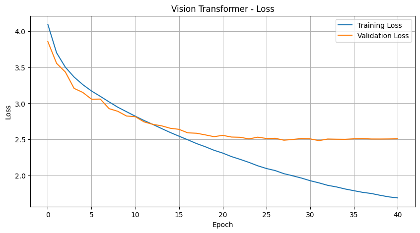
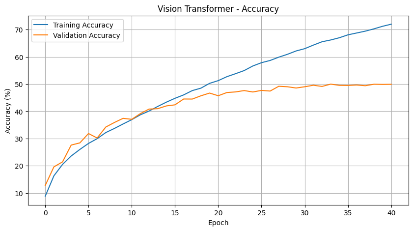
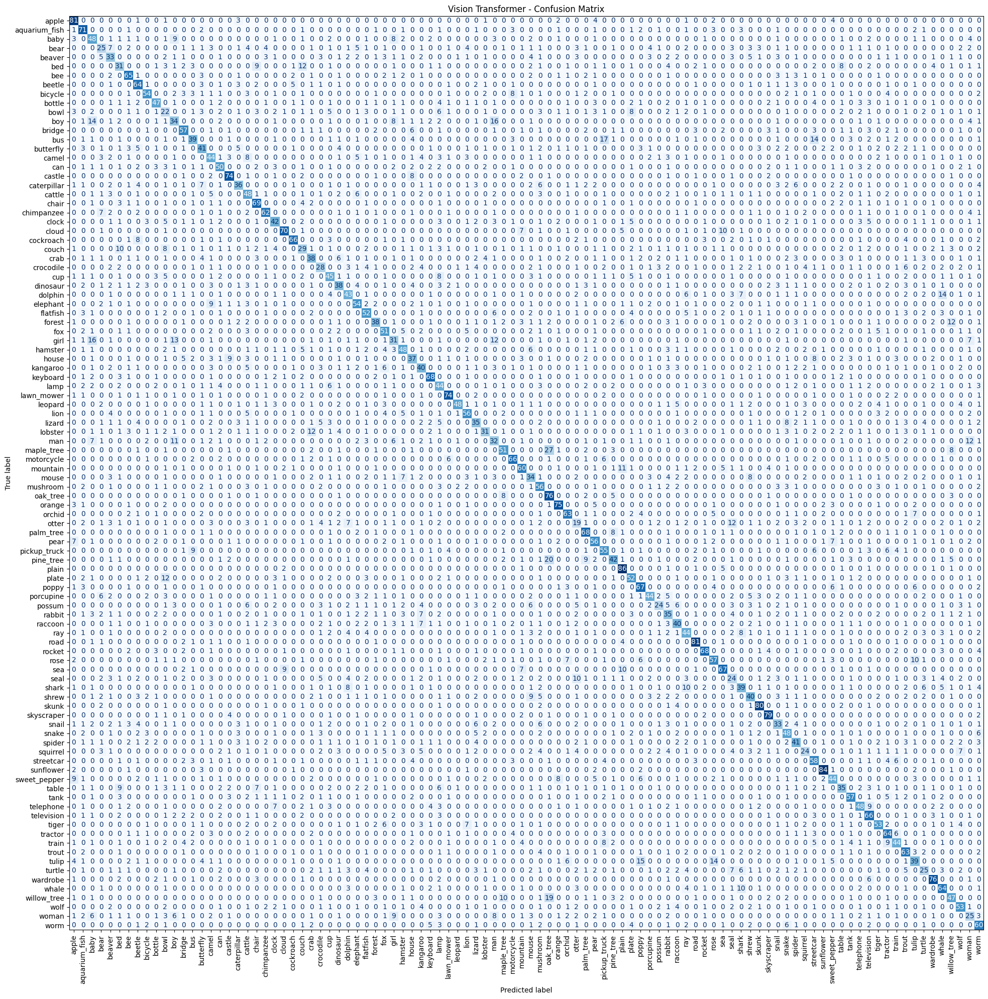

# ViT_CIFAR-100
# Kết quả triển khai Vision Transformer (ViT) trên CIFAR-100

- Run_Model.ipynb: File chạy mô hình để dự đoán ảnh mới.
- best_vit_cifar.pth: File lưu trọng số mô hình tốt nhất.
- cifar_classes.json: Lưu danh sách 100 nhãn của CIFAR-100.
- ViT_Cifar_100: Notebook triển khai và huấn luyện mô hình.

## Tổng quan quá trình huấn luyện

Mô hình Vision Transformer (ViT) được triển khai trên bộ dữ liệu CIFAR-100 nhằm thực hiện bài toán phân loại ảnh đa lớp. Mô hình được xây dựng bằng PyTorch, khởi tạo trọng số từ đầu (training from scratch), không sử dụng mô hình pretrained.

Bộ dữ liệu CIFAR-100 bao gồm 100 lớp đối tượng, với 50.000 ảnh trong tập huấn luyện ban đầu và 10.000 ảnh trong tập kiểm tra. Tập huấn luyện được chia thành 45.000 ảnh Training và 5.000 ảnh Validation nhằm phục vụ quá trình huấn luyện, theo dõi hiệu quả mô hình và lựa chọn checkpoint tốt nhất.

Mô hình được huấn luyện tối đa 50 Epoch, kết hợp với Early Stopping nhằm hạn chế việc huấn luyện kéo dài khi hiệu suất trên tập Validation không còn cải thiện.

## Cấu hình mô hình

| Tham số | Giá trị |
|---|---|
| Kiến trúc | Vision Transformer (ViT) |
| Dataset | CIFAR-100 |
| Image Size | 32 × 32 |
| Patch Size | 4 × 4 |
| Số Patch | 64 |
| Số Token (bao gồm CLS) | 65 |
| Embedding Dimension | 192 |
| Transformer Depth | 6 |
| Number of Heads | 6 |
| MLP Dimension | 384 |
| Dropout | 0.1 |
| Số lớp đầu ra | 100 |
| Loss Function | CrossEntropyLoss + Label Smoothing (0.1) |
| Optimizer | AdamW |
| Learning Rate | 0.0005 |
| Weight Decay | 0.05 |
| Scheduler | CosineAnnealingLR |
| Số Epoch tối đa | 50 |
| Early Stopping Patience | 7 |

## Kết quả huấn luyện

Sau quá trình huấn luyện, mô hình đạt được các kết quả trên tập Training và Validation như sau:

| Chỉ số | Kết quả |
|---|---:|
| Số Epoch thực hiện | 50 |
| Training Accuracy cuối | 72.00% |
| Validation Accuracy cuối | 49.92% |
| Validation Loss cuối | 2.5066 |
| Validation Accuracy cao nhất | 49.98% |
| Epoch đạt Validation Accuracy cao nhất | 34 |

  

Mô hình đạt Validation Accuracy cao nhất là 49.98% tại Epoch 34. Mặc dù Accuracy trên tập Training tiếp tục tăng trong quá trình huấn luyện, hiệu suất trên tập Validation có mức cải thiện hạn chế, cho thấy mô hình gặp khó khăn trong việc duy trì khả năng tổng quát hóa trên dữ liệu chưa được sử dụng trực tiếp để cập nhật trọng số.

## Kết quả đánh giá trên tập Test

Sau khi lựa chọn checkpoint tốt nhất dựa trên kết quả Validation, mô hình được đánh giá trên tập Test gồm 10.000 ảnh, với kết quả như sau:

| Chỉ số | Kết quả |
|---|---:|
| Best Epoch | 34 |
| Best Validation Accuracy | 49.98% |
| Test Loss | 2.4587 |
| Test Accuracy | 50.32% |
| Macro Precision | 50.28% |
| Macro Recall | 50.32% |
| Macro F1-score | 49.85% |
| Weighted Precision | 50.28% |
| Weighted Recall | 50.32% |
| Weighted F1-score | 49.85% |

  

Mô hình đạt độ chính xác 50.32% trên tập Test. Macro F1-score đạt 49.85%, cho thấy hiệu suất phân loại tổng thể giữa các lớp ở mức tương đối đồng đều về trọng số đánh giá, tuy nhiên khả năng phân loại vẫn còn hạn chế ở một số lớp đối tượng.

## Đánh giá kết quả phân loại theo từng lớp

Mô hình được đánh giá trên toàn bộ 100 lớp của CIFAR-100 thông qua các chỉ số Precision, Recall và F1-score. Mỗi lớp có 100 mẫu trong tập Test.

  

Một số lớp đạt hiệu suất phân loại tốt:

| Lớp | Precision | Recall | F1-score |
|---|---:|---:|---:|
| sunflower | 83.17% | 84.00% | 83.58% |
| plain | 64.66% | 86.00% | 73.82% |
| road | 74.31% | 81.00% | 77.51% |
| orange | 72.82% | 75.00% | 73.89% |
| skyscraper | 69.30% | 79.00% | 73.83% |
| lawn_mower | 71.15% | 74.00% | 72.55% |
| apple | 63.28% | 81.00% | 71.05% |
| cockroach | 76.74% | 66.00% | 70.97% |
| castle | 67.89% | 74.00% | 70.81% |
| rocket | 70.10% | 68.00% | 69.04% |

Một số lớp có hiệu suất phân loại thấp hơn:

| Lớp | Precision | Recall | F1-score |
|---|---:|---:|---:|
| bowl | 19.13% | 22.00% | 20.47% |
| otter | 22.89% | 19.00% | 20.77% |
| seal | 25.81% | 24.00% | 24.87% |
| bear | 33.78% | 25.00% | 28.74% |
| squirrel | 38.10% | 24.00% | 29.45% |
| woman | 31.25% | 25.00% | 27.78% |
| turtle | 30.49% | 25.00% | 27.47% |
| possum | 45.28% | 24.00% | 31.37% |
| couch | 34.52% | 29.00% | 31.52% |
| mouse | 32.69% | 34.00% | 33.33% |

Các lớp có hiệu suất cao thường có đặc trưng hình ảnh tương đối dễ nhận diện trong tập dữ liệu hoặc có những đặc điểm hình thái, màu sắc, bố cục nổi bật. Trong khi đó, một số lớp có hiệu suất thấp có thể chịu ảnh hưởng từ sự tương đồng về hình ảnh, kích thước ảnh nhỏ, đặc trưng phân biệt hạn chế hoặc độ phức tạp của hình ảnh.

## Nhận xét và phân tích

Kết quả đánh giá cho thấy mô hình Vision Transformer được xây dựng từ đầu đã đạt Test Accuracy 50.32% trên bộ dữ liệu CIFAR-100. Đây là kết quả thể hiện mô hình có khả năng học và phân biệt các đặc trưng hình ảnh của 100 lớp đối tượng, tuy nhiên hiệu suất vẫn còn hạn chế.

Một số nhận xét chính:

- **Khả năng học đặc trưng:** Mô hình đạt Training Accuracy 72.00%, cho thấy mô hình đã học được các đặc trưng từ tập dữ liệu huấn luyện. Tuy nhiên, hiệu suất trên tập Validation và Test thấp hơn đáng kể.
- **Khoảng cách giữa Training và Validation:** Training Accuracy cuối đạt 72.00%, trong khi Validation Accuracy cuối đạt 49.92%, chênh lệch khoảng 22.08 điểm phần trăm. Điều này cho thấy mô hình có dấu hiệu overfitting, khi khả năng học trên dữ liệu huấn luyện tốt hơn khả năng tổng quát hóa trên dữ liệu chưa được sử dụng để cập nhật trọng số.
- **Khả năng phân loại giữa các lớp:** Hiệu suất giữa 100 lớp không đồng đều. Một số lớp đạt F1-score trên 70%, trong khi một số lớp có F1-score thấp hơn 30%, cho thấy mô hình chưa xử lý tốt tất cả các nhóm đối tượng.
- **Checkpoint tốt nhất:** Mô hình được lựa chọn tại Epoch 34 dựa trên Validation Accuracy cao nhất 49.98%, thay vì sử dụng trọng số tại Epoch cuối cùng. Điều này giúp đảm bảo kết quả Test được đánh giá từ checkpoint có hiệu suất Validation tốt nhất trong quá trình huấn luyện.

## Kết luận

Việc triển khai Vision Transformer trên bộ dữ liệu CIFAR-100 đã hoàn thành quá trình xây dựng kiến trúc, huấn luyện, lựa chọn checkpoint và đánh giá mô hình. Mô hình đạt Test Accuracy 50.32%, Macro F1-score 49.85%.

Kết quả cho thấy Vision Transformer có khả năng thực hiện bài toán phân loại ảnh trên bộ dữ liệu CIFAR-100 khi được huấn luyện từ đầu. Tuy nhiên, mô hình vẫn còn dấu hiệu overfitting và hiệu suất phân loại chưa đồng đều giữa các lớp.

Để cải thiện kết quả trong các thử nghiệm tiếp theo, có thể xem xét điều chỉnh cấu trúc mô hình, tăng cường dữ liệu, tối ưu các siêu tham số, áp dụng các kỹ thuật regularization phù hợp hoặc sử dụng mô hình pretrained để tận dụng các đặc trưng đã được học từ những bộ dữ liệu lớn hơn.
